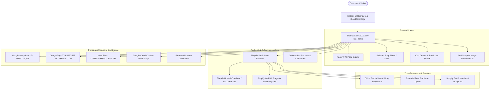
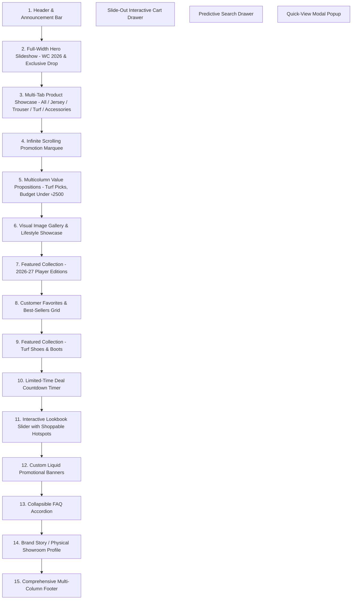
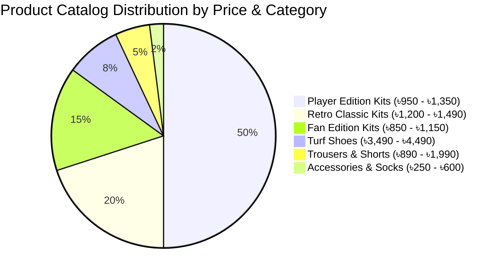

# Comprehensive Website Analysis: BySports Bangladesh
**Website URL:** [https://bysportsbd.com/](https://bysportsbd.com/)  
**Document Generated:** September 2026  
**Subject:** In-depth Technical, Design, Feature, and Operational E-Commerce Audit  

---

## 1. Executive Summary & Brand Overview

**BySports** is an emerging direct-to-consumer (D2C) sportswear and fan apparel e-commerce brand operating in Bangladesh. The platform specializes in Thailand-imported and replica/player-issue football kits, national team jerseys (with heavy focus on the 2026 World Cup), retro kits, turf shoes, trousers, and training accessories.

The business operates a **hybrid omnichannel model**, combining a high-traffic e-commerce storefront with a brick-and-mortar showroom in Dhaka.

| Key Entity | Details |
| :--- | :--- |
| **Brand Name** | BySports (BySports BD) |
| **Primary Domain** | `https://bysportsbd.com/` |
| **Shopify Internal Subdomain** | `sv04tj-mv.myshopify.com` |
| **Physical Showroom** | House #48, Road #03, Block #E, Banasree, Rampura, Dhaka-1219, Bangladesh |
| **Operating Hours** | 10:00 AM – 10:30 PM (7 days a week) |
| **Trade License** | TRAD/DSCC/002648/2025 (Dhaka South City Corporation) |
| **Primary Contact** | +880 1754-724991 / +880 1629-381501 |
| **Email Support** | `support@bysportsbd.com`, `bysportsbd@gmail.com` |
| **Target Audience** | Football fans, amateur athletes, turf football players, gym-goers in Bangladesh |

---

## 2. Complete Technology Stack & Infrastructure

The site is built on a modern Shopify SaaS infrastructure, leveraging a customized premium theme, page-builder extensions, conversion optimization apps, and advanced tracking configurations.



### Detailed Tech Stack Breakdown:

| Category | Component / Vendor | Technical Specification & Role |
| :--- | :--- | :--- |
| **E-Commerce Platform** | **Shopify SaaS** | Hosted enterprise e-commerce platform (`myshopify.com` root `sv04tj-mv`). |
| **Store Theme** | **Sleek (v2.2.0)** by **FoxTheme** | Premium Shopify Theme Store template (Store ID: `2821`), custom named `Wildpeak`. Built for high conversion, micro-animations, and fast mobile loading. |
| **Content & Landing Pages** | **PageFly AI Page Builder** | Extension app (`pagefly-ai-page-builder-359`). Powers custom promotional landing pages, A/B testing modules (`PAGEFLY_CRO`), snap sliders, and responsive grid layouts. |
| **Agentic / AI Discovery** | **Shopify WebMCP** (Model Context Protocol) | Cutting-edge protocol (`webmcp-c6b62ece.js`) enabling AI agents and crawlers to invoke tools directly (e.g. `search_shop_policies_and_faqs`) via `/api/mcp` and `sitemap_agentic_discovery.xml`. |
| **Upsell & Average Order Value (AOV)** | **Essential Post Purchase Upsell** | Post-checkout one-click upsell engine (`essential-post-purchase-upsell-1718`) offering add-ons after transaction completion. |
| **Conversion Tools** | **Cirkle Studio App Proxy** | App proxy (`sbzstag.cirkleinc.com`) powering smart sticky add-to-cart buttons and sales urgency triggers. |
| **CDN & Caching** | **Shopify CDN** | Edge asset delivery via `bysportsbd.com/cdn/` and global CDN endpoints with WOFF2 font caching and WebP/AVIF auto-formatting. |
| **Digital Security & Anti-Scrape** | **Custom Vanilla JS Protection** | Disables right-click on `` elements, blocks drag-to-save, and prevents keyboard shortcuts (`Ctrl+S`, `Ctrl+U`, `Ctrl+Shift+I`). |
| **Bot Detection** | **hCaptcha & Shopify Protection** | Integrated form protection (`ce_storefront_forms_captcha_hcaptcha.v1.5.3`) securing login, contact, and guest checkout forms. |
| **Analytics & Pixel Architecture** | **Shopify Web Pixels Manager** | Sandboxed pixel orchestration supporting: <br>• **GA4**: `G-7M6PTJVQZB`<br>• **Google Tag IDs**: `GT-K557G56S`, `MC-T8BNLSTCJM`<br>• **Facebook Pixel**: `1752103598834318` + Server-Side Conversions API (CAPI) with full customer data matching scopes.<br>• **Custom Pixel**: Hosted on Google Cloud Storage (`storage.googleapis.com/gsf-scripts/custom-pixels/sv04tj-mv.js`). |

---

## 3. Design System & Visual Identity

The design language balances **modern Scandinavian editorial minimalism** with the **dynamic urgency** demanded by sports culture.

### 3.1 Typography
*   **Headings / Display Font:** `Fraunces` (Google Serif font)  
    *   *Usage:* Editorial headers, promotional banners, collection titles.
    *   *Visual Effect:* Lends a premium, bespoke, high-fashion athletic brand tone rather than a standard discount sports shop.
*   **Body & UI Font:** `DM Sans` (Geometric Sans-Serif)  
    *   *Weights:* 400 (Regular), 500 (Medium), 700 (Bold).
    *   *Usage:* Navigation menus, product titles, pricing, variant swatches, checkout labels.
    *   *Visual Effect:* Highly legible on high-density mobile screens with clean letter-spacing (`0.05em`).

### 3.2 Color Architecture & Schemes

The site implements 11 predefined CSS variable color schemes configured in `:root`:

```css
/* Primary Active Brand Palette */
--color-primary: 214, 58, 47;          /* #D63A2F - Vibrant Crimson Red (Brand Accent) */
--color-background: 255, 255, 255;      /* Crisp White (Main Canvas) */
--color-secondary-background: 247, 247, 247; /* Off-White / Light Grey */
--color-foreground: 0, 0, 0;            /* Pure Black Text */
--color-border: 230, 230, 230;          /* Clean Separator Grey */

/* E-Commerce Status Badges */
--color-badge-sale: #C6512C;            /* Warm Orange/Red */
--color-badge-hot: #000000;             /* Stark Black */
--color-badge-new: #67785D;             /* Earthy Olive Green */
--color-badge-soldout: #A5A4AB;         /* Muted Slate Grey */
--color-cart-bubble: #D63A2F;           /* Crimson Attention Marker */
```

*   **Warm Earthy Sub-Schemes:** Schemes 2, 3, 4, 8, and 10 introduce warm sand and cream backgrounds (`#F3F0EC`, `#F0EAE3`, `#F8F4F1`) giving jersey photo shoots a warm, tactile, lifestyle feel.
*   **Scheme 6 & Inverse:** High-contrast dark backgrounds (`#000000` and deep terracotta `#86614D`) used for high-impact promotional blocks and World Cup features.

### 3.3 Layout & Structural Tokens
*   **Maximum Container Width:** `1410px` (optimized for 1080p and 1440p displays without stretching).
*   **Corner Radii:**
    *   Buttons & Form Fields: `0.5rem` (5px rounded rectangular look).
    *   Product Cards: `1.0rem` (10px rounded corners for a modern card aesthetic).
    *   Inner Media Containers: `0.6rem` (6px nested radius).
*   **Buttons & CTAs:** Uppercase, letter-spaced (`0.05em`), solid black fill with white text, transitioning to red on hover/interaction.

---

## 4. Comprehensive Feature Breakdown

### 4.1 Header & Top-Level Navigation
1.  **Announcement Ticker / Header Utility:**
    *   Dynamic top marquee promoting free delivery thresholds and hot offers.
    *   Social links integrated directly into the header bar (Facebook, Instagram, TikTok, YouTube).
2.  **Navigation Architecture (Desktop & Mobile):**
    *   **Home**
    *   **Club Jersey 26-27** (Dedicated highlight for upcoming season kits)
    *   **Club Jersey** (Top European clubs: Real Madrid, Barcelona, Arsenal, Man City, Man United, Inter Milan, AC Milan, Bayern, PSG, AS Roma, etc.)
    *   **World Cup 2026** (Argentina, Brazil, Portugal, France, Italy, Germany)
    *   **National Jersey** (International teams)
    *   **Retro Jersey** (Classics: 1994 Maradona, 1998/2002/2006 Argentina, 1999 Barcelona, 2005-06 Arsenal Highbury, 2012-13 Real Madrid)
    *   **Kids Jersey** (Children's fan sets)
    *   **Player Edition vs. Fan Edition** (Filtered by kit tier)
    *   **Trouser & Shorts** (Men's training pants, gym trousers)
    *   **Turf Shoes** (Football turf shoes for artificial grass pitches)
    *   **Football Accessories** (Grip socks, shin guards, captain armbands)
    *   **Contact** (Showroom address, map, phone, WhatsApp)
3.  **Predictive Live Search Drawer:**
    *   Powered by Shopify's `/search/suggest` API.
    *   Displays instant product thumbnail results, variant prices, and collection recommendations as user types.
4.  **Sticky Mobile Bottom Bar / Compact Header:**
    *   Seamless touch-friendly hamburger drawer with accordions for deep navigation.

---

### 4.2 Homepage Merchandising Architecture

The homepage is composed of **19 structured Shopify sections** configured for aggressive conversion:



1.  **Hero Slideshow:** Cinematic banners featuring "Exclusive Collection", "World Cup 2026", and direct "Shop Now" CTAs.
2.  **Product Tabs Section ("So, what else is new?"):** AJAX-powered tab switcher allowing users to browse All, Jersey, Trouser, Turf, and Accessories without page reloads.
3.  **Scrolling Marquee:** Continuous CSS marquee highlighting high quality, Thailand imports, and express delivery.
4.  **Curated Value Proposition Cards:**
    *   *Top Picks Made for the Turf:* Low-profile sole design explanation.
    *   *Under ৳2,500 Turf Collection:* Entry-level pricing hook.
    *   *New Arrivals:* Urgency trigger.
5.  **Lookbook Slider:** Shoppable visual lifestyle imagery linking kit styling to individual product cards.
6.  **Collapsible FAQ Accordion:** Handles core buyer objections upfront (Delivery times, Packaging, Domestic shipping limits, Payment methods).
7.  **Physical Showroom Spotlight:** Showcases the Banasree brick-and-mortar store to build massive trust in a market often plagued by unverified online sellers.

---

### 4.3 Product Page (PDP) & Customization Engine

The product detail page is engineered specifically for football kit buyers with specialized custom line-item properties:

1.  **Jersey Personalization / Name & Number Printing:**
    *   Line-item property text input: `properties[Personalize Your Jersey (+Tk 250)]`.
    *   Placeholder: `"Enter name & number — e.g. Mesi 10"`.
    *   Enables automated order notes with customer custom printing specifications.
2.  **Sizing & Options Switcher:**
    *   Jerseys: **M, L, XL, 2XL** (interactive pill buttons).
    *   Turf Shoes: **40, 41, 42, 43, 44, 45** (European shoe sizing).
    *   Sleeve Variants: Short Sleeve vs. Full Sleeve.
3.  **Sticky Add-to-Cart Bar:**
    *   Persists at the top or bottom of the mobile/desktop viewport as the customer scrolls through product descriptions.
4.  **Product Informational Accordions:**
    *   **Product Details:** Cut, fabric technology (AeroReady / Dri-Fit), embroidery vs. heat-pressed badges.
    *   **Washing & Care Instructions:** Machine wash cold, do not bleach, hang dry in shade, iron inside out avoiding embroidery.
    *   **Size Chart:** Configured modal drawer for chest/length dimensions.
    *   **Shipping & WhatsApp Support:** Direct delivery rates and fast-click WhatsApp hotline (`+880 1754-724991`).
5.  **High-Resolution Multi-Angle Photography:**
    *   4 to 5 high-resolution (3072x4080 native) real-life studio shots per kit showing badges, fabric weave, tag, and back view.

---

### 4.4 Cart Drawer & Checkout Flow

Rather than redirecting to a traditional cart page, clicking the cart icon or adding an item triggers a **Slide-Out Cart Drawer** loaded with conversion hooks:

1.  **Free Shipping Threshold Progress Bar:**
    *   Dynamic calculation showing: *"Spend Tk X more to reach free shipping!"*.
2.  **In-Drawer Order Notes:**
    *   Enables customers to leave special instructions for packaging, custom names, or courier drop-offs.
3.  **In-Drawer Shipping Estimator:**
    *   Allows immediate shipping rate calculation prior to entering the checkout tunnel.
4.  **In-Drawer Coupon / Discount Code Input:**
    *   Applies promotional voucher codes directly without navigating away.
5.  **Recommended Products / Cross-Sells:**
    *   When the cart is empty or holds a single jersey, displays quick-add suggestions (e.g. grip socks, shorts).
6.  **Checkout Infrastructure:**
    *   Shopify One-Page Checkout.
    *   Guest checkout supported with automated phone/address persistence.

---

## 5. Catalog, Pricing & Merchandising Strategy

A comprehensive scan of BySports' 260+ active products reveals a disciplined multi-tier pricing strategy:



### Pricing Tiers Breakdown:

| Category | Price Range (BDT) | Dominant Price Point | Key Characteristics |
| :--- | :--- | :--- | :--- |
| **Fan Edition Jerseys** | ৳850 – ৳1,150 | **৳890** | Thailand-imported, embroidered club crests, regular comfortable fit, durable washability. |
| **Player Edition Jerseys** | ৳950 – ৳1,350 | **৳1,150** | Athletic slim-fit, heat-pressed badges, ventilation holes, breathable lightweight performance fabric. |
| **Retro Jerseys** | ৳1,200 – ৳1,490 | **৳1,200** | Nostalgia kits from 1994–2014, classic collar details, felt sponsor prints. |
| **Kids Jerseys / Kits** | ৳750 – ৳950 | **৳850** | Complete matching set (jersey + shorts) for youth players. |
| **Turf Football Shoes** | ৳3,490 – ৳4,490 | **৳4,000 / ৳4,490** | Nike Phantom, Mercurial, and Predator turf studs designed for artificial turf grass. |
| **Trousers & Shorts** | ৳890 – ৳1,990 | **৳1,190** | Club training pants, dry-fit shorts, zipper joggers. |
| **Jersey Personalization** | +৳250 | **৳250** | Custom vinyl name and squad number printing service. |
| **Sports Accessories** | ৳250 – ৳600 | **৳250 – ৳350** | Anti-slip grip socks, sweatbands, shin guards. |

---

## 6. Business Operations, Payments & Logistics

### 6.1 Payment Gateway Ecosystem
1.  **Cash on Delivery (COD):**
    *   **Inside Dhaka:** 100% Cash on Delivery with zero advance required.
    *   **Outside Dhaka:** Delivery fee (৳120) collected in advance via mobile financial services (bKash/Nagad) to confirm serious intent, balance paid on delivery.
2.  **Online Payment Partner (SSLCommerz):**
    *   Mobile Financial Services: **bKash, Nagad, Rocket**.
    *   Debit/Credit Cards: **Visa, Mastercard, American Express (Amex)**.
    *   Internet Banking: Direct debit through major Bangladeshi scheduled banks.

### 6.2 Domestic Logistics & Delivery Timelines

| Region | Delivery Fee | Lead Time | Courier Delivery Method | Advance Required |
| :--- | :--- | :--- | :--- | :--- |
| **Dhaka City** | **৳70 – ৳80** | 1 – 2 working days | Home Delivery (Pathao / Steadfast / RedX) | None (Full COD) |
| **Outside Dhaka (63 Districts)** | **৳120** | 2 – 3 working days | Condition Courier / Thana Hub Delivery | ৳120 delivery fee advance |
| **International** | N/A | Not supported | Currently domestic Bangladesh only | N/A |

### 6.3 Return, Refund & Warranty Policy
*   **Inspection Period:** 3 days from delivery date to report defects, wrong sizing, or transit damage.
*   **Damage Claim Requirement:** Must be verified in front of the delivery agent at the time of unboxing.
*   **Change of Mind:** Allowed if products are undamaged and unworn, but customer covers round-trip courier fees.
*   **Refund Policy:** Strictly issued for **out-of-stock items** that cannot be fulfilled within 7–10 working days. Refund processed in 5–7 business days.

---

## 7. Strategic Evaluation: Strengths, Vulnerabilities & Actionable Recommendations

### 7.1 Key Competitive Strengths
1.  **Massive Trust Anchor via Physical Showroom:** Operating a verifiable showroom in Banasree, Rampura with a public trade license drastically reduces the "scam anxiety" common in Bangladeshi social commerce.
2.  **Laser-Targeted Product Catalog:** Capitalizing on the 2026 FIFA World Cup hype early with Argentina, Brazil, Italy, Portugal, and France player edition kits.
3.  **Modern E-Commerce UX:** Unlike competitors who rely on clunky WooCommerce setups or simple Facebook Messenger orders, BySports uses an optimized Shopify flow with an interactive slide-out cart drawer, line-item customization, and predictive search.
4.  **Advanced Ad Tracking Setup:** Fully configured Facebook Conversions API (CAPI) and Google Tag Manager with customer data matching, enabling efficient Retargeting and Lookalike audience generation.
5.  **Adoption of Next-Gen Protocols:** Early integration of Shopify's WebMCP agentic discovery endpoints.

### 7.2 Vulnerabilities & Technical Flaws Identified

| Area | Identified Flaw / Issue | Risk Level |
| :--- | :--- | :--- |
| **PDP Size Chart** | The collapsible `Size Chart` accordion tab is currently empty (`rte` container contains no data). | **High** (Causes sizing uncertainty, leading to high exchange rates). |
| **Spelling Inconsistencies** | URL handles containing typographical errors (e.g. `/collections/shocks` instead of `socks`, and `traning` instead of `training`). | **Medium** (Harms organic search keyword matching and brand polish). |
| **Shipping Price Discrepancy** | Product shipping tab quotes `৳80` inside Dhaka, while the Shipping Policy page quotes `৳70`. | **Medium** (Creates minor customer confusion at checkout). |
| **Anti-Scraping Script** | Disabling right-click and keyboard inspector keys (`Ctrl+S`, `Ctrl+Shift+I`) is easily bypassed via dev tools and degrades power-user accessibility. | **Low** |
| **Out-of-Stock Catalog Noise** | Several retro and fan editions display unavailable sizes without back-in-stock alerts. | **Medium** (Lost lead capture opportunities). |

### 7.3 Actionable Growth & Optimization Roadmap

1.  **Populate Comprehensive Size Charts:**
    *   Embed a structured dimension table (Chest Width, Length, Recommended Height/Weight) directly inside the product accordion and size modal.
2.  **Integrate One-Click Courier API (Steadfast / Pathao):**
    *   Deploy a dedicated automated Shopify-to-Steadfast/Pathao courier order pushing app to automate parcel consignment and tracking SMS generation.
3.  **Implement Direct WhatsApp Order / Quick Buy Button:**
    *   In the Bangladesh market, many customers prefer placing orders via WhatsApp. Adding a "Quick Order via WhatsApp" button prefilled with the jersey title and selected size can lift conversions by 15–25%.
4.  **Fix URL Slugs & Redirects:**
    *   Create 301 redirects from `/collections/shocks` to `/collections/socks` to capture natural organic search queries.
5.  **Implement Automated Back-in-Stock Alerts:**
    *   Deploy an app like *Globo Back in Stock* or *Klaviyo* to capture customer phone numbers/emails when popular player sizes (L, XL) sell out.

---

## 8. Summary Table of Store Properties

| Property | Value |
| :--- | :--- |
| **Store Name** | BySports |
| **Live URL** | [bysportsbd.com](https://bysportsbd.com/) |
| **CMS Platform** | Shopify SaaS |
| **Active Theme** | FoxTheme "Sleek" v2.2.0 (Theme Store ID: 2821) |
| **Page Builder** | PageFly AI Page Builder |
| **Primary Currency** | BDT (Tk / ৳) |
| **Language** | English (Storefront) & Bengali (Policy/Shipping details) |
| **Product Count** | 260+ Active Products |
| **Delivery Scope** | Nationwide Bangladesh (64 Districts) |
| **Payment Gateways** | Cash on Delivery (COD), SSLCommerz (bKash, Nagad, Cards) |
| **Customer Support Channels** | Phone, WhatsApp (+880 1754-724991), Email, Banasree Showroom |
